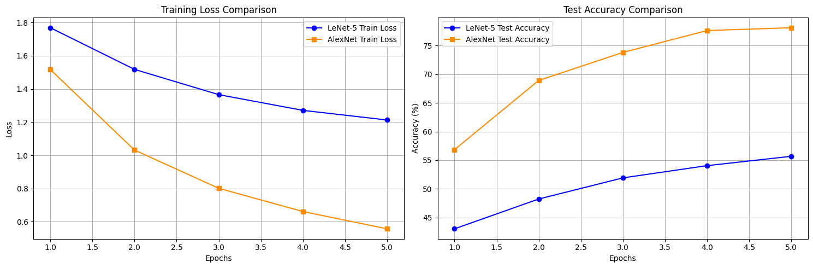
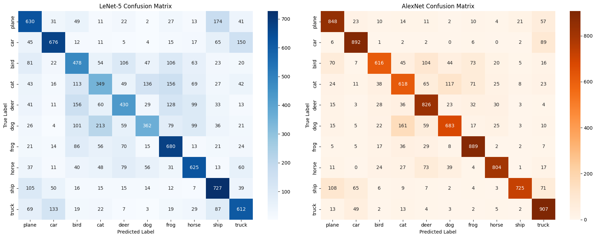

# LeNet-5 vs AlexNet on CIFAR-10

A PyTorch reimplementation and head-to-head benchmark of two landmark convolutional networks: **LeNet-5**
(LeCun et al., 1998) and **AlexNet** (Krizhevsky et al., 2012). Both are trained under the same conditions on
CIFAR-10 to measure what fourteen years of architecture changes bought in accuracy and what they cost in compute.

## Results

Both models were trained for 5 epochs with Adam on a Tesla T4 GPU (LeNet-5 lr = 1e-3, AlexNet lr = 1e-4).

| | LeNet-5 | AlexNet |
|---|---|---|
| Parameters | ~60K | ~60M |
| Input size | 32 × 32 × 3 | 224 × 224 × 3 (resized) |
| Test accuracy | 55.7% | **78.1%** |
| Final training loss | 1.21 | **0.56** |
| Time per epoch | **13.7 s** | 133.1 s |

AlexNet is **22.4 points more accurate** but **9.7× slower per epoch**.

Per-class F1 on the 10,000-image test set:

| Class | LeNet-5 | AlexNet | | Class | LeNet-5 | AlexNet |
|---|---|---|---|---|---|---|
| plane | 0.60 | 0.80 | | frog | 0.60 | 0.84 |
| car | 0.69 | 0.87 | | horse | 0.61 | 0.84 |
| bird | 0.46 | 0.70 | | ship | 0.66 | 0.82 |
| cat | 0.38 | 0.63 | | truck | 0.61 | 0.82 |
| deer | 0.47 | 0.76 | | dog | 0.43 | 0.71 |

Cats and dogs are the hardest classes for both models. AlexNet's biggest gains are on exactly those
fine-grained animal classes.

## What changed between 1998 and 2012

| Feature | LeNet-5 (1998) | AlexNet (2012) | Effect |
|---|---|---|---|
| Activation | Tanh | ReLU | No saturation, so gradients flow through deeper stacks and training converges faster. |
| Pooling | Average | Overlapping max | Keeps the strongest responses and slightly reduces overfitting. |
| Regularisation | None | Dropout (0.5) + data augmentation | Makes a 60M-parameter model trainable without memorising the data. |
| Normalisation | None | Local Response Normalisation | Lateral inhibition between feature maps (since replaced by BatchNorm). |
| Scale | 7 layers, ~60K params | 8 layers, ~60M params | ~1000× more capacity for complex colour features. |
| Hardware | CPU | Two GPUs in parallel | Made the scale above practical. |

## Implementation notes

- **LeNet-5** follows the original paper, with the first convolution changed to accept 3-channel RGB input at 32 × 32.
- **AlexNet** follows the 2012 paper, including LRN and overlapping pooling. CIFAR images are resized to 224 × 224 on the fly.
- Both models share one training/evaluation pipeline that tracks loss, accuracy and time per epoch, then
  produces classification reports and confusion matrices.

## Files

| File | Contents |
|---|---|
| `lenet5_vs_alexnet_cifar10.ipynb` | Background, both implementations, training, evaluation and conclusions |
| `lenet5_vs_alexnet_slides.pptx` | Slide deck summarising the architectures and results |
| `training_curves.png`, `confusion_matrix.png` | Result figures |

## Run it

Open the notebook in Google Colab, select a GPU runtime, and run all cells. CIFAR-10 downloads automatically
through `torchvision`.

**Stack:** PyTorch · torchvision · scikit-learn · matplotlib

---
Abrham Yilma · Built during my MSc at Addis Ababa University
